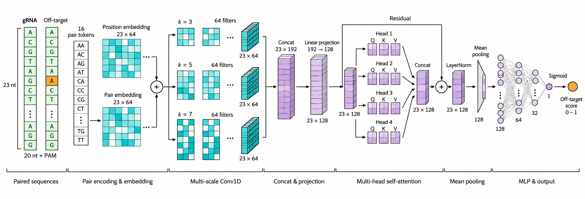

# MosqGuide-Off

MosqGuide-Off predicts an off-target activity probability for a supplied gRNA–candidate-site sequence pair. It provides an NGG-specific model (pam_ngg, 23 nt) and a PAM-agnostic model (pam_agnostic, 20 nt). Each combines a deep learning model and a random forest using probability calibration and ensemble prediction. The random forest uses handcrafted features, supports feature importance analysis, and contributes to prediction alongside the deep learning model.



*Figure 1. Architecture of the NGG-specific deep learning model. Paired 23-nt sequences pass through sequence-pair embeddings, multiscale convolutions, self-attention, and a probability prediction layer.*

This repository demonstrates off-target models that output a predicted probability for a single gRNA–candidate-site sequence pair. For guide-level off-target risk and on-target activity assessment, refer to [MosqEdits-full-pipeline](https://github.com/GeneEditing/MosqEdits-full-pipeline).

## Installation

The intended environment is Linux x86_64 with Python 3.10. From the repository root:

```bash
conda env create -f env/environment.yml
conda activate mosqguide-off
```

The environment specifies PyTorch `1.13.0+cu117` and the required Python packages. The demo uses the CPU by default; CUDA is optional for inference. Deep learning training uses CUDA by default.

## Data and model files

The repository contains the source code, small PyTorch checkpoints, and probability calibrators. For inference, download only the random forest model for the selected profile; the six processed CSV files are for training and evaluation. Save downloaded files at the **repository-relative paths** below. The two model directories contain files with identical names and must be kept separate.

| Save as | HTTP download URL (copy into your browser if clicking does not start the download) |
| --- | --- |
| `pam_ngg/data/train.csv` | `http://1.12.219.134/1s2ZOEQeaKN3KC9a7qNF/resources/MosqGuide-Off/pam_ngg/data/train.csv` |
| `pam_ngg/data/val.csv` | `http://1.12.219.134/1s2ZOEQeaKN3KC9a7qNF/resources/MosqGuide-Off/pam_ngg/data/val.csv` |
| `pam_ngg/data/test.csv` | `http://1.12.219.134/1s2ZOEQeaKN3KC9a7qNF/resources/MosqGuide-Off/pam_ngg/data/test.csv` |
| `pam_ngg/checkpoints/rf_handcrafted_baseline.joblib` | `http://1.12.219.134/1s2ZOEQeaKN3KC9a7qNF/resources/MosqGuide-Off/pam_ngg/checkpoints/rf_handcrafted_baseline.joblib` |
| `pam_agnostic/data/train.csv` | `http://1.12.219.134/1s2ZOEQeaKN3KC9a7qNF/resources/MosqGuide-Off/pam_agnostic/data/train.csv` |
| `pam_agnostic/data/val.csv` | `http://1.12.219.134/1s2ZOEQeaKN3KC9a7qNF/resources/MosqGuide-Off/pam_agnostic/data/val.csv` |
| `pam_agnostic/data/test.csv` | `http://1.12.219.134/1s2ZOEQeaKN3KC9a7qNF/resources/MosqGuide-Off/pam_agnostic/data/test.csv` |
| `pam_agnostic/checkpoints/rf_handcrafted_baseline.joblib` | `http://1.12.219.134/1s2ZOEQeaKN3KC9a7qNF/resources/MosqGuide-Off/pam_agnostic/checkpoints/rf_handcrafted_baseline.joblib` |

<details>
<summary>SHA-256 checksums for the eight downloaded files</summary>

```text
40505957e855c2849dce88d2e9573088ea2a94ab3147b289c5975a72547bfd68  pam_ngg/data/train.csv
94fc3d7507fd1d849a91bbed4b2218c2846bd1162b08cbd2a6a3ccaa8c8fc9b9  pam_ngg/data/val.csv
631a0993573cf152eac1de44864169f0777e32a46a468585218d31915e9529e0  pam_ngg/data/test.csv
e81f289db15e2f14bfbe3a3d0295931ad0490fd4f30dc75d9d9dcd00da4a30bf  pam_ngg/checkpoints/rf_handcrafted_baseline.joblib
d731add42d8802ac77b52762dd18fbc27d231b418be896935592863c5245d2fd  pam_agnostic/data/train.csv
1f28d04e2669d5509c7c47edd13f3fce0ec390e7e4c68492c0d7c3180f70c43d  pam_agnostic/data/val.csv
5e18c3f746cddc0fbe3c2a868aa3c1baac2c190e1c20bcb700443ff55fb19661  pam_agnostic/data/test.csv
54e51ca602ed970584942e130dd1999064fe9d1e9af652291afb65c05b9081ad  pam_agnostic/checkpoints/rf_handcrafted_baseline.joblib
```

Run `sha256sum <path>` on a downloaded file to compare its checksum.

</details>

## Run the sequence-pair demo

For inference, download the random forest model for the profile you want to use; the training CSV files are not needed. The released deep learning checkpoint, both calibrators, and ensemble JSON must also be present under that profile's `checkpoints/` directory.

From the repository root, score the included one-pair example with the NGG model:

```bash
python run_demo.py
```

The default input is `examples/demo_pairs.csv`, the default model is `ngg`, and the default output is `results/demo_predictions.csv`. To score your own CSV or use the PAM-agnostic model:

```bash
python run_demo.py --input /path/to/pairs.csv --output results/ngg_predictions.csv --model-profile ngg --device cpu
python run_demo.py --input /path/to/pairs.csv --output results/pam_agnostic_predictions.csv --model-profile pam-agnostic --device cpu
```

Use `--device cuda:0` for optional CUDA inference and `--batch-size` to control inference batches. Run `python run_demo.py --help` for all options. Relative input and output paths you provide are resolved from your working directory; built-in defaults and model paths are resolved from the script location, so the repository can be moved.

### Input CSV

```csv
candidate_id,guide_id,sgRNA_20nt,off_target_20nt,candidate_pam,guide_pam
candidate_000000001,gRNA_0001,TTAGAGCCTATTTAGATTGA,TCAGAGACATTTCAGTTTGA,GGG,GGG
```

- All six columns are required. `candidate_id` must be unique and both identifiers must be nonempty; they are metadata, not model features. One row is sufficient, and multiple rows are supported.
- `sgRNA_20nt` and `off_target_20nt` must each contain exactly 20 concrete A/C/G/T bases, written in the same guide-oriented convention.
- `guide_pam` is the actual PAM at the guide's intended target; `candidate_pam` is the actual PAM at the supplied candidate site. Supply concrete bases such as `GGG`, not an IUPAC pattern such as `NGG`. Both PAM columns must be nonempty.
- `ngg` requires both PAMs to match NGG. Each 20 nt sequence is concatenated with its own 3 nt PAM, giving a 23 nt model input and 93 handcrafted features.
- `pam-agnostic` uses only the two 20 nt sequences and 81 handcrafted features. The PAM columns are retained as metadata but do not affect its prediction.

### Output probability

The output preserves the input columns (required sequence columns are normalized to uppercase) and adds `off_target_probability`. For one row, the probability is also printed in the terminal. The prediction is:

```text
off_target_probability = w * calibrated_DL_probability + (1 - w) * calibrated_RF_probability
```

The deep learning ensemble weight `w` is `0.86` for NGG and `0.84` for PAM-agnostic; the random forest weight is `1 - w`.

This is the predicted probability for the supplied sequence pair, not an aggregate off-target risk value for the entire gRNA.

## Reproduce model training

After downloading the CSV files, run either training pipeline from the repository root:

```bash
(cd pam_ngg && DEVICE=0 bash run_training_pipeline.sh)
(cd pam_agnostic && DEVICE=0 bash run_training_pipeline.sh)
```

Each script trains the deep learning and random forest models, selects the ensemble weight on the validation split, and fits probability calibrators. Outputs are written to the corresponding `checkpoints/` directory; back up the released checkpoints before retraining. The default training seed is 42. Further model and training parameters are defined in the scripts and `env/environment.yml`.

## Dataset provenance

The modeling data are derived from the public dataset accompanying [Yaish and Orenstein (2024)](https://doi.org/10.1093/nar/gkae428), available from the authors' [CRISPR-Bulge repository](https://github.com/OrensteinLab/CRISPR-Bulge). We selected mismatch-only guide–off-target pairs without insertion/deletion bulges. CHANGE-seq is the principal source; GUIDE-seq data associated with Tsai et al. (2015), Chen et al. (2017), and Listgarten et al. (2018) increase guide diversity.

We removed sequence pairs with conflicting labels and created our own **guide-disjoint** train, validation, and test splits. GUIDE-seq negative samples in the training split were downsampled by guide and mismatch count while retaining positive samples. Validation and test samples were not downsampled. These are our final processed modeling files, **not** the original paper's data partition. They permit retraining and evaluation from the same inputs; reconstructing them from the upstream tables requires the data-preparation workflow.

`label = 1` denotes a site detected as active by the source assay. `label = 0` denotes a candidate site classified as inactive because it was not detected as active. The source dataset generated such candidates by sequence-based search; they are not randomly generated negatives or sites individually proven inactive by a separate experiment.

Both configurations have 116 training guides, 15 validation guides, and 15 test guides, with no guide shared across splits. Their sample counts differ because NGG uses 23 nt sequences and PAM-agnostic uses 20 nt sequences:

| Model | Train | Validation | Test |
|---|---:|---:|---:|
| NGG | 1,878,500 | 332,704 | 313,301 |
| PAM-agnostic | 1,805,356 | 324,891 | 304,529 |

Each CSV contains `guide_id`, `sgRNA`, `off_target`, `mismatch_count`, `label`, `spacer`, `dataset`, `assay`, and `source`.

## License

This project is licensed under the MIT License. See [LICENSE](LICENSE) in the repository.
